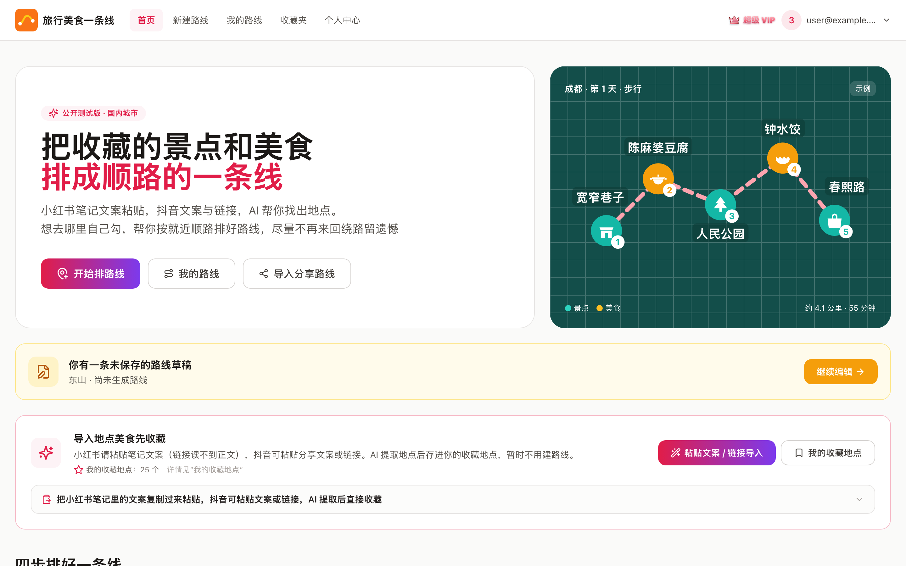
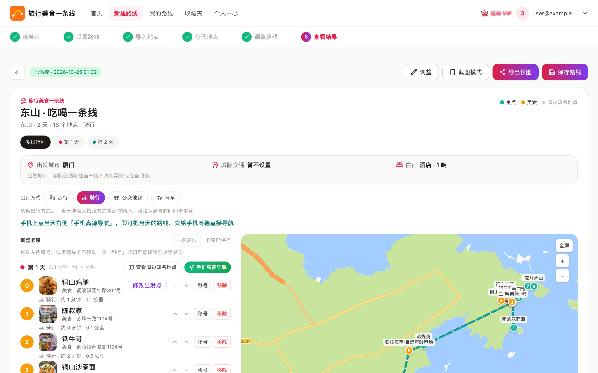
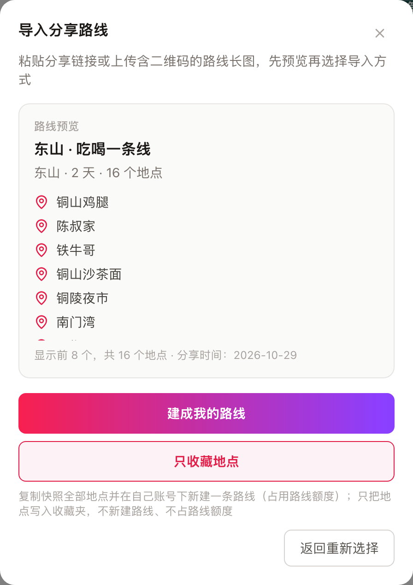
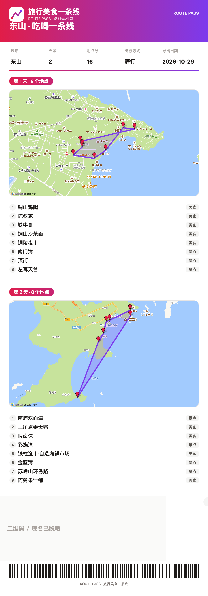
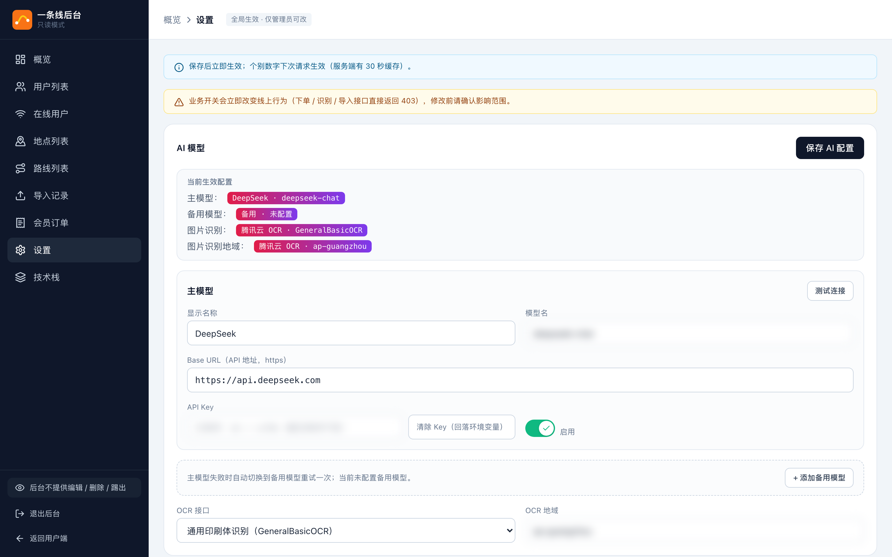

# 旅行美食一条线（Travel Food Route Planner）

把小红书 / 抖音里收藏的景点与美食，按**「顺路」排成一条行程线**，给出地图与分段里程；可保存、可分享、可导出机票风格长图。

> 这不是一个"用户量很大"的产品，而是一条真实跑通的业务链路：**粘贴文案 → AI 提取地点 → 按城市校验 → 顺路排序 → 地图里程 → 分享 / 长图**。
> 重点是把「地点归属、额度并发、异常处理、验收」做对——这三个地方出过错，也都补了测试与数据体检。

---

## 一、项目状态

| 项 | 现状 |
|---|---|
| 代码 | Next.js 14（App Router）+ React 18 + TypeScript strict + Tailwind：**25 个页面、35 个 API、48 个组件、31 个 lib 模块、28,618 行 TS/TSX** |
| 提交 | **139 次提交**（2026-10-15 ~ 10-25），提交信息按 `feat / fix / docs / test / chore` 分域 |
| 测试 | **113 条单元测试（13 个文件）+ 8 条 Playwright E2E**，全绿；另有 4 个自检脚本（环境 / 库结构 / 城市一致性 / 地点水体体检） |
| 文档 | **36 份 Markdown**：需求、架构、模块地图、数据模型、接口契约、ADR、并发审计、水体体检报告、部署、操作手册、技术栈、阶段交接 |
| 任务 | **T-001 ~ T-063**，一个任务一张卡（`tasks/`），每张带可数验收判据与回滚方式 |
| 数据 | **15 张表 / 32 份迁移 / 109 个城市 / 1,367 个地点**；`check:schema` 63 项对象体检全过 |
| 并发 | 下单、建路线、分享导入均改为**事务内原子占额**；实测见下表 |
| 使用者 | 内测阶段（作者 + 少量朋友），未公开运营 |
| 发布 | 域名备案中；当前为局域网自建部署（Windows 跑 Supabase，Mac/Windows 跑应用） |
| 安全 | 仓库不含任何真实 API Key；`.env.local` 从未入库；**收款码图片不入库**（本地放置） |

### 并发实测（不是推理，是真跑）

| 场景 | 结果 |
|---|---|
| 同一用户 10 并发下单（待核销上限 2） | **2 成功 / 8 拒绝**，库内 pending 恰好 2 |
| 额度剩 1 时 10 并发建路线 | **1 成功 / 9 拒绝**，库内路线恰好 1 |
| 同一草稿 5 并发导入分享路线 | **5×200 同一 routeId**，库内路线恰好 +1 |
| 匿名调用内部 RPC | **401**（仅 service_role 可执行） |

---

## 二、解决什么问题

自助旅行者的真实动作是：刷到几十个想吃想去的 → 全塞进收藏夹 → 真到排行程时卡住：

1. **不知道先去哪、后去哪**：收藏是一堆点，行程是一条线，中间那步靠人脑。
2. **排顺序要开地图一个个量**：一天 8 个点量 7 段距离，来回改。
3. **分享只能截图**：同伴拿到图还得自己再抄一遍到地图里。

产品把「一堆点」变成「一条线」：AI 提取 → 按城市校验 → 最近邻 + 2-opt 排序 → 地图与里程 → 保存 / 分享 / 长图。

---

## 三、核心功能

| 模块 | 能力 |
|---|---|
| **游客试用** | 选城市 → 设行程 → 加地点 → 调顺序 → 看地图与里程**全开放**；只有「保存」需要登录。花钱接口按成本分桶限流（提取 / 距离矩阵 3 次/日，只读 100 次/日） |
| **AI 提取地点** | 粘贴小红书文案（或抖音分享文案/链接）→ 模型按 JSON 约束输出「城市 + 地点」→ 直接进收藏。后台可换模型/地址/Key，**主模型失败自动切备用** |
| **图片识别** | 截图/长图上传或 **⌘V 直接粘贴** → 腾讯云 OCR → 文本回填 → 复用同一条提取流程；**图片只在内存过一趟，不落盘不入库** |
| **城市归属校验** | 高德检索加 `citylimit`，按 adcode **精确到区县**（区县必须相等、地级市比前 4 位、直辖市比前 2 位）；adcode 缺失用逆地理补；**没有同城结果宁可不写地址** |
| **同名点不漂** | POI 打分：水体 −5、停车场/公交站 −3、景区 +5、有具体地址 +2、名称前缀 +2，优先「岸上的景区/街道」 |
| **路线排序** | 最近邻 + 2-opt；距离走高德距离矩阵并**落库缓存**，同一对点不重复计费；住宿点不占号位 |
| **额度与并发** | 正常用户 1 条/日、会员 5 条/月、AI 提取与 OCR 有每日上限；下单/建路线/分享导入全部走**事务内 advisory 锁 + 计数 + 写入**的 RPC |
| **分享导入闭环** | 分享生成 token + 快照；对方粘贴链接**或上传含二维码长图** → **先预览**（标题/城市/天数/前 8 个地点）→ 再选「建成我的路线（占额度）」或「只收藏（不占额度）」 |
| **导出长图** | Canvas 画成**登机牌风格**：票头 logo、城市/天数/地点数/出行方式、**每天一张静态地图截图**、站点清单、撕票虚线、二维码、条形码 |
| **后台可运维** | 设置页分块保存（AI 模型 / 业务开关 / 配额数字，**真实生效**）；概览显示高德与 OCR 用量；所有配额与开关都能改，不用改代码 |
| **数据体检** | `check:schema` 63 项、`check:cities` 城市三处一致、`scan:water` 全库地点水域风险扫描（当前水体点 0） |

---

## 功能截图

> 截图为演示数据且**已脱敏**：邮箱/手机号/内网 IP/API Key/分享 token/二维码均已打码；后台「技术栈」等内部页面不公开。

<p align="center">
  
  
</p>
<p align="center">
  
  
</p>
<p align="center">
  
  
</p>

---

## 四、技术架构

```text
浏览器 / 手机浏览器
   │
   ▼
Next.js 14（App Router）
   · 页面（Server Components）
   · Route Handlers ×35（鉴权 / 配额 / 算路 / 分享）
   │
   ├── Cookie 会话 ──▶ 自建 Supabase
   │                    PostgreSQL 15 · GoTrue · PostgREST
   │                    RLS · pg_cron · 原子 RPC ×4
   │
   └── HTTPS ────────▶ 外部服务
                        高德 JS API + Web 服务 Key 池
                        DeepSeek（主 / 备模型）
                        腾讯云 OCR
                        企业微信（订单提醒）
```

| 层 | 技术 |
|---|---|
| 前端 | Next.js 14.2（App Router）· React 18 · TypeScript strict · TailwindCSS 3 · lucide-react · Canvas 2D 出图 |
| 服务端 | Next.js Route Handlers（35 个）· Node 运行时 · 手写参数校验 · Cookie 会话（`@supabase/ssr`） |
| 数据 | 自建 Supabase：PostgreSQL 15 + GoTrue + PostgREST + RLS + pg_cron + 原子 RPC（32 份迁移） |
| 地图与算路 | 高德 JS API（展示）· 高德 Web 服务（检索/距离矩阵/静态图）· 双 Key 池 + 落库缓存 |
| AI | DeepSeek（文案提取，主/备可切换）· 腾讯云 OCR（图片识别，通用/高精度可切换） |
| 质量 | vitest 113 条 · Playwright 8 条 · 移动端审计脚本 · 4 个自检脚本 |
| 部署 | 局域网：Windows（Supabase Docker）+ 应用；公网方案：云机 Nginx + 反向隧道（备案后启用） |

### API 分组（35 个）

| 分组 | 代表接口 |
|---|---|
| 鉴权 | `POST /api/auth/login`、`/api/auth/register`、`/api/auth/logout` |
| 城市与地点 | `GET /api/cities`、`POST /api/places`、`DELETE /api/places/[id]` |
| 路线 | `POST /api/routes`、`PUT /api/routes/[id]/places`、`GET/PATCH /api/routes/[id]` |
| AI | `POST /api/ai/extract`、`POST /api/ai/extract-image` |
| 高德 | `POST /api/amap/route`、`GET /api/amap/staticmap` |
| 分享 | `GET /api/shares/[token]`、`POST /api/shares/[token]/import` |
| 会员 | `POST /api/member/orders`、`GET /api/member/orders/status` |
| 后台 | `/api/admin/settings`、`/api/admin/settings/test-llm`、`/api/admin/member/orders/[id]` |

---

## 五、权限与安全

- **身份**：邮箱注册 + Cookie 会话（`@supabase/ssr`）；middleware 做路由守卫，API 内部再校验一次用户（不信任前端）。
- **权限**：
  - 15 张表启用 RLS；用户只能读写自己的 `places / routes / route_places`；
  - `user_daily_usage / app_settings` 等只允许服务端（service_role）访问；
  - 会员开通、订单核销、设置修改、用户列表全部在后台接口校验 `users.admin`。
- **内部 RPC 边界**：`create_member_order_guarded`、`create_route_guarded`、`replace_route_places`、`approve_member_order` 均 `security definer` + `search_path=''` + **显式撤销 anon/authenticated 执行权限**（匿名调用实测 401）。
- **密钥边界**：
  - 仓库不含任何真实 Key；`Project/.env.local` 从未入库（`git log --all -- Project/.env.local` 为空）；
  - 后台录入的模型 Key 只存服务端，读取只返回掩码（`sk-••••a7db`），前端拿不到明文；
  - 模型 Base URL 强制 https 且禁止内网/回环地址（防 SSRF）。
- **图片**：OCR 图片只在内存处理，不落盘、不入库、不进对象存储。
- **收款码**：`Project/public/pay-qr-*.png` 含经营者信息，**不入库**（已在 `.gitignore`）；本地运行需自行放置。

---

## 六、数据模型（15 张表）

| 表 | 用途 | 关键字段 |
|---|---|---|
| `users` | 账号与会员 | `email`、`admin`、`member`、`member_until`、`member_source`、`trial_multi_day_used` |
| `cities` | 城市字典（109） | `name`、`adcode` |
| `places` | 地点/收藏（用户级） | `user_id`、`city_id`、`name`、`type`、`lat`、`lng`、`address`、`is_collected`、`geo_status` |
| `routes` / `route_places` | 路线与点位顺序 | `days`、`transport`、`imported_from`；`day_index`、`order_index`、`slot` |
| `route_shares` | 分享快照 | `token`、`snapshot`(jsonb)、`revoked_at` |
| `member_orders` / `member_logs` | 订单与核销记录 | `plan`、`amount`、`pay_channel`、`status` |
| `user_daily_usage` | 按日额度计数 | `user_id`、`day`、`kind`、`count` |
| `amap_usage` / `amap_leg_cache` / `amap_geocode_cache` | 高德用量与缓存 | `key_slot`、`service`、`calls`、`failures` |
| `imports` / `events` / `app_settings` | 导入记录、埋点、全局设置 | `status`、`event_name`、`value`(jsonb) |

---

## 七、本地运行

### 前置

- Node.js 18+
- 一台能跑 Supabase 的机器（本文档默认 **Windows + Docker Desktop**，也可用云 Supabase）
- 高德 Web 服务 Key（建议 2 个，做 Key 池）、DeepSeek Key、腾讯云 OCR 密钥（可选）

### 步骤

1. 复制环境变量模板并填写（**不要提交**）：
   ```bash
   cd Project
   cp .env.example .env.local   # 若无模板，按 docs/操作手册.md 的变量清单新建
   ```
   必需：`NEXT_PUBLIC_SUPABASE_URL`、`NEXT_PUBLIC_SUPABASE_ANON_KEY`、`SUPABASE_SERVICE_ROLE_KEY`、`NEXT_PUBLIC_AMAP_KEY`、`NEXT_PUBLIC_AMAP_SECURITY_CODE`、`AMAP_WEB_SERVICE_KEY`
   可选：`AMAP_WEB_SERVICE_KEY_2`、`DEEPSEEK_API_KEY`、`TENCENT_OCR_SECRET_ID/KEY/REGION`、`ORDER_NOTIFY_WECOM_WEBHOOK`

2. 初始化数据库：按 `Project/supabase/migrations/` 顺序执行 32 份 SQL（Supabase SQL Editor 或 `/pg/query`）。

3. 启动：
   ```bash
   cd Project
   npm ci
   npm run dev          # http://localhost:3000
   ```
   Windows 也可直接双击 `windows/启动项目.bat`：自动检查 Supabase → 构建/启动应用 → 打开浏览器 → 打印手机测试地址。

4. 自检：
   ```bash
   npm run check:env      # 环境 / Supabase / dev 探活
   npm run check:schema   # 库结构 63 项
   npm run check:cities   # 城市三处一致
   ```

> Supabase 地址建议用**主机名**而不是 IP（本项目踩过：DHCP 换 IP 后整站连不上）。详见 `docs/deployment.md` 附录。

---

## 八、测试与验收

| 项 | 内容 |
|---|---|
| 单元测试 | **113 条 / 13 个文件**（`npm run test:run`）：排序、分享 token、配额、POI 打分、adcode 判定、模型兜底、设置校验、原子写路线 |
| 端到端 | **8 条**（`npm run test:e2e`）：登录、排路线、保存、收藏、分享、导入 |
| 移动端 | `npm run audit:mobile`：390px 视口横向溢出检查 |
| 库结构 | `npm run check:schema`：15 表 / 10 函数 / 10 约束 / 17 关键列 / pg_cron / RLS，共 63 项 |
| 数据体检 | `npm run scan:water`：全库地点水域风险扫描（1,345 条评估，水体点 0） |

**测试压在出过事的地方**（不是凑覆盖率）：

| 关注点 | 对应测试 / 证据 |
|---|---|
| 地点跨市/跨区县错配 | `tests/unit/amap-adcode.test.ts` + `docs/water-risk-report.md` |
| 水体/同名点落错位置 | `tests/unit/amap-poi-score.test.ts` |
| 并发超发（下单 / 建路线 / 分享导入） | `docs/concurrency-audit.md`（含实测数字） |
| 模型不可用 | `tests/unit/llm.test.ts`（主备切换） |
| 设置项校验（URL/枚举/范围） | `tests/unit/app-settings.test.ts` |
| 原子替换路线点位 | `tests/unit/t020-atomic-routes.test.ts` |

---

## 九、已知限制（诚实清单）

| 限制 | 说明 |
|---|---|
| 未公开运营 | 内测阶段（作者 + 少量朋友），未验证真实付费转化 |
| 备案未完成 | 域名备案审核中，当前只有局域网部署；公网访问依赖备案后的 Nginx + 隧道 |
| 单机数据库 | Supabase 跑在一台 Windows（Docker），无主从/自动故障转移；靠每日 `pg_dump` 备份 |
| IP 会漂 | 局域网 DHCP 分配地址，已在配置里改用主机名；长期应做路由器地址保留或静态 IP |
| AI 地名仍需人工确认 | 已做城市限定 + adcode 精确 + POI 打分 + 全库体检，但跨省同名景点仍可能错，不假装 100% 自动 |
| 长文截断 | 超长笔记文案会截断后送模型，可能漏掉尾部地点 |
| 无 CI | 测试与构建靠本地执行；未接 GitHub Actions |
| 埋点口径 | 事件为产品内自埋，非第三方统计；量小，仅用于自查 |
| 技术栈页 | 后台内部页面，未在本文档公开截图与细节 |

---

## 十、工程过程

1. **先审计**：接手半成品代码，先读现有实现并记录事实（`docs/existing-project-audit.md`、`architecture.md`、`module-map.md`）。
2. **列问题**：确认缺陷与风险登记在 `docs/known-issues.md`（A/B/C/S 分级，含复现与证据）。
3. **按任务做**：`tasks/T-0xx.md` 一份任务卡，写清目标 / 不做什么 / 验收标准 / 测试方案 / 回滚 / 风险等级。
4. **写测试**：单测 113 + E2E 8，重点压在权限、并发、地名归属、设置校验。
5. **补自检**：`check:env` / `check:schema` / `check:cities` / `scan:water`，把"上线前该绿的"变成命令。
6. **出文档**：操作手册、技术栈、思维逻辑、部署、并发审计、水体体检报告、阶段交接摘要。

### 踩过并修掉的问题（可查）

| 问题 | 现象 | 修法 |
|---|---|---|
| 地点跨市错配 | 东山的「铜陵夜市」被匹配到安徽铜陵 | `citylimit` + adcode 精确到区县 |
| 同地级市跨区县 | 「铁牛哥」跑到漳州芗城区 | 区县必须精确相等（`adcodeWithin`） |
| 水面点 | 「南门湾」标在海里 | POI 打分（水体/停车降权，景区加权） |
| 并发超发 | 10 并发能突破额度 | 事务内 advisory 锁 + 计数 + 写入 |
| 分享二维码不可识别 | 长图二维码被画布裁切 | 修正页脚高度 + 提高二维码分辨率 |
| 手机端埋点丢失 | 浏览器直连 `127.0.0.1` | 改为同源 `POST /api/events` |
| DHCP 换 IP | 整站 `ECONNREFUSED` | 配置改主机名 + 文档记录定位方法 |

---

## 十一、文档索引

| 想知道什么 | 看哪份 |
|---|---|
| 日常怎么操作 | [docs/操作手册.md](docs/操作手册.md) |
| 技术栈全貌 | [docs/技术栈文档.md](docs/技术栈文档.md) |
| 为什么这么设计 | [docs/项目思维逻辑.md](docs/项目思维逻辑.md) |
| 部署与上线 | [docs/deployment.md](docs/deployment.md) |
| 代码结构与模块 | [docs/architecture.md](docs/architecture.md)、[docs/module-map.md](docs/module-map.md) |
| 数据结构 | [docs/data-model.md](docs/data-model.md) |
| 接口约定 | [docs/api-contract.md](docs/api-contract.md) |
| 为什么这么改 | [docs/decisions.md](docs/decisions.md) |
| 有哪些坑 | [docs/known-issues.md](docs/known-issues.md) |
| 并发问题与实测 | [docs/concurrency-audit.md](docs/concurrency-audit.md) |
| 地点数据体检 | [docs/water-risk-report.md](docs/water-risk-report.md) |
| 进度看板 | [docs/progress.md](docs/progress.md) |

---

## 十二、AI 参与边界

编码由 AI 辅助执行；**数据模型、权限判断、异常处理、验收测试由作者把关**。

本项目修掉的 6 类真实缺陷（跨市错配、跨区县错配、水面点、并发超发、二维码裁切、埋点跨端）全部落在这四处，因此这部分不接受"AI 说通过"：
每个结论都要有可复跑的命令或实测数据，未覆盖的项在文档里明确标注「未覆盖」。

---

## 十三、License

见 [LICENSE](LICENSE)。源码公开用于作品展示与代码审阅，未经许可不得商用或再分发。
